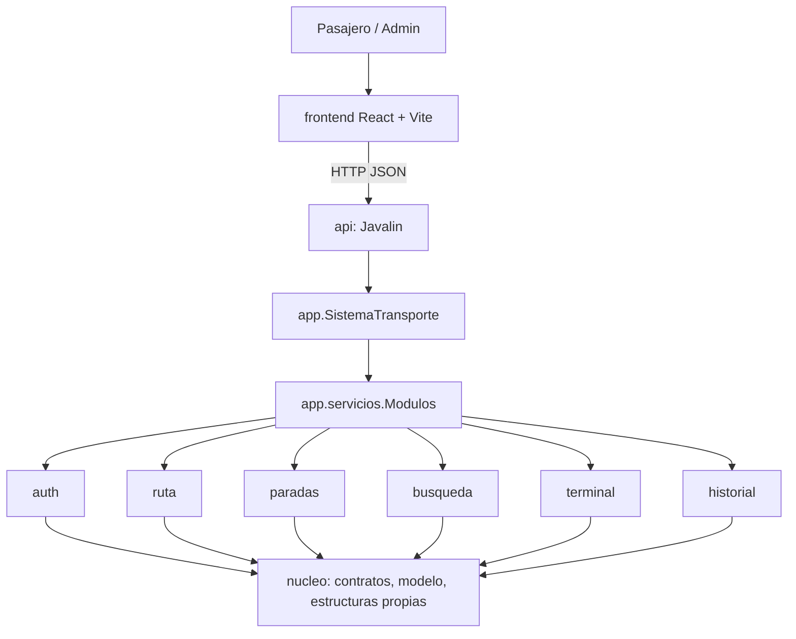
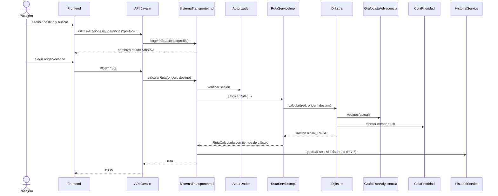
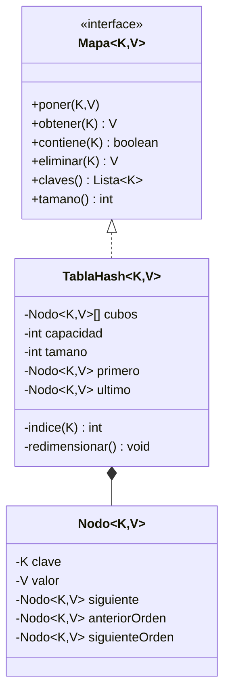

# RutaSV — Reporte técnico final (Fase 3)

**Programación con Estructuras de Datos — PED941**  
**Universidad Don Bosco — Ciclo 02-2026**  
**Fecha de entrega:** 25 de noviembre al 5 de diciembre de 2026  
**Fecha de este documento:** 25 de noviembre de 2026  
**Repositorio:** https://github.com/franc1sc0sv/rutasv-ped941  
**Estado documentado:** `main` en el commit `28cac62` (último merge de la Fase 3)

Integrantes: Yoselyn Guadalupe Aguilar Rivera (AR253073), Rubel Alberto Andrade Campos (AC251900), Francisco Josué Hernández Meléndez (HM242655), Leandro Alberto Valencia Escobar (VE242685) y Carlos Eduardo Saavedra Vega (SV253275).

Documentos complementarios: [entrega de la Fase 2](entrega-fase2.md), [arquitectura](arquitectura.md), [contratos](contratos.md), [decisiones](decisiones.md), [tabla hash](tabla-hash.md), [rendimiento](rendimiento.md), [API](api.md), [guion de Ruta](documento-ruta.md) y [tareas por rol](tareas-por-rol.md).

---

## Resumen ejecutivo

RutaSV quedó terminado y funcional de punta a punta. El sistema permite iniciar sesión con roles, buscar estaciones con autocompletado, calcular la ruta más rápida con Dijkstra, consultar el historial y las estadísticas, administrar la red vial y las paradas, y despachar unidades con filas de pasajeros. Las siete estructuras de datos del curso están implementadas por el equipo, probadas y conectadas; ya no queda ninguna clase `Temporal` ni dependencia de `java.util` para guardar datos del dominio.

El cierre de la Fase 3 se resume así:

| Evidencia | Resultado |
|---|---|
| Commit base de Fase 2 → cierre de Fase 3 | `bbf1e7f` → `28cac62` |
| Pull requests integrados | #41, #42, #43, #44, #45 y #46 |
| Cambio total | 128 archivos, +2 841 / −1 355 líneas |
| Pruebas automáticas | **268**: 257 en `core` + 11 en `api`; 0 fallos, 0 errores, 1 omitida intencionalmente |
| CI de GitHub en `28cac62` | `build: success`, `frontend: success` |
| Compilación local del frontend | `tsc --noEmit && vite build`: 77 módulos, sin errores |
| Demo | `./demo.sh --limpio`: red sintética de 30 estaciones, 83 tramos, usuarios y 30 rutas de ejemplo |
| Estructuras propias | 7 de 7, con pruebas de contrato |

La prueba omitida es `MedicionesRendimientoTest`: solo corre con `-Drendimiento=true` porque reescribe `docs/rendimiento.md` y tarda varios segundos; por eso no se ejecuta en el CI normal. Las mediciones ya generadas están en [rendimiento.md](rendimiento.md).

---

## 1. Problema, alcance y reglas de negocio

### 1.1 Problema

Un pasajero necesita decidir rápido cómo llegar de una estación a otra usando transporte público, sin conocer la red completa. Un administrador necesita mantener esa red: dar de alta, editar y desactivar paradas, registrar tramos y ver la operación. El problema es de búsqueda sobre un grafo disperso con pesos positivos: las consultas se repiten mucho, los tramos cambian poco y la red crece por estaciones conectadas a pocas vecinas.

La solución es un planificador con tres capas:

1. Un **core Java 21** sin frameworks, donde viven el modelo, los contratos, las siete estructuras propias, los algoritmos y los servicios.
2. Una **API HTTP delgada** en Javalin que traduce cada petición a una llamada de `SistemaTransporte`; no contiene lógica de negocio.
3. Un **frontend React + Vite + TypeScript** con una carpeta por rol.

### 1.2 Funcionalidad núcleo

- **Auth:** registro, login por roles (`PASAJERO`, `ADMIN`) y creación del administrador inicial por variables de entorno.
- **Paradas:** alta, edición, activación/desactivación, búsqueda por código o nombre, carga de CSV con errores por línea.
- **Ruta:** cálculo de la ruta más rápida, vista de la red, alta de tramos.
- **Búsqueda:** autocompletado por prefijo normalizado y últimas cinco rutas consultadas por usuario.
- **Terminal:** despacho de unidades y filas de pasajeros.
- **Historial:** rutas guardadas por usuario, historial global, estadísticas y top 5 de pares origen→destino.

### 1.3 Reglas de negocio

| Código | Regla | Implementación final |
|---|---|---|
| RN-1 | Solo el administrador da de alta, edita o desactiva estaciones y tramos; el pasajero solo consulta. | `Autorizador`, fachada y pantallas de administración; `DirectorioEstaciones` con `estacion.activa`. |
| RN-2 | El peso de un tramo es positivo, en minutos enteros entre 1 y 1440; km finitos no negativos. | `GrafoListaAdyacencia.agregarTramo` lanza `ValidacionException`. |
| RN-3 | Una calle de doble sentido son dos tramos dirigidos; registrar el mismo sentido otra vez lo reemplaza. | Mapa `origen → Mapa(destino → Arista)` en el grafo. |
| RN-4 | Exprés antes que normal; entre igual tipo, hora más próxima; si empatan tipo y hora, menor id. | `ReglaDespacho` y `MonticuloBinario` con `Comparator`. |
| RN-5 | Los pasajeros abordan en estricto orden de llegada. | Una `ColaEnlazada` por tipo de ruta (NORMAL/EXPRES) y una tabla id→tipo para evitar duplicados. |
| RN-6 | Si no hay camino, se informa y no se guarda nada en el historial. | `Dijkstra` devuelve `SIN_RUTA`; la fachada no llama a `HistorialService`. |
| RN-7 | Toda ruta calculada se guarda con fecha, tiempo total, kilómetros y secuencia de estaciones. | `RutaServiceImpl` construye `RutaCalculada`; `SistemaTransporteImpl` la guarda. |

---

## 2. Cambios realizados respecto a la Fase 2

La Fase 2 cerró con seis estructuras conectadas y una pendiente: la tabla hash propia estaba en construcción y el sistema usaba adaptadores `Temporal` detrás de los contratos. La Fase 3 cerró esa brecha y transformó el proyecto entregable en un sistema de demostración estable.

| Pendiente de Fase 2 | Estado final en Fase 3 | Evidencia |
|---|---|---|
| `TablaHash` en construcción y `MapaTemporal` en el cableado | `TablaHash<K,V>` propia, activa y movida a `nucleo.estructuras.impl`; eliminadas todas las clases `Temporal` | PR #41 y #42; `TablaHashTest`, `TablaHashContratoTest`, `ArquitecturaTest` |
| Falta de edición y activación/desactivación de paradas | `DirectorioEstaciones.actualizar` y `activarDesactivar`, con validación de unicidad y actualización de la red | PR #43; `ParadasYRobustezTest`, `DirectorioEstacionesTest` |
| Terminal sin dueño único de RN-5 | `Terminal` es dueña de las filas por tipo y expone `verOrdenDespacho` sin vaciar la cola | PR #43; `TerminalOrdenTest`, `DespachoFigura10Test` |
| Métricas y Big-O sin medición propia | `MedicionesRendimientoTest` y `docs/rendimiento.md` con mediana de 7 corridas y normalización por Big-O | PR #45 |
| Datos de ejemplo insuficientes para defender | Red sintética de 30 estaciones/83 tramos, 5 unidades, 30 rutas en el historial y `demo.sh` | PR #44 y #46; `DatosDemoTest`, README |
| Documentación dispersa y contratos desactualizados | README final, guías por rol, contrato HTTP y este reporte | PR #45 y este documento |

### 2.1 Historial de integración

| PR | Rama | Propósito |
|---|---|---|
| #41 | `feat/paradas-tabla-hash` | Implementación de `TablaHash`, integración en Paradas y respuesta a la revisión del PR. |
| #42 | `refactor/nucleo-estructuras` | Estructuras genéricas movidas a `nucleo.estructuras.impl`; borrado de adaptadores temporales. |
| #43 | `feat/paradas-edicion-robustez` | Edición/activación de estaciones, validaciones y filas de Terminal. |
| #44 | `feat/datos-demo` | Red de demostración y datos semilla. |
| #45 | `docs/rendimiento-y-documentacion` | Documentación final, contrato de API y mediciones. |
| #46 | `fix/demo-robusta` | Ajustes detectados al grabar los recorridos de demostración. |

> Nota: la tabla del PR #41 se revisó en el PR #40; el merge en `main` se hizo desde la rama `feat/paradas-tabla-hash` mediante #41. El detalle técnico está en [tabla-hash.md](tabla-hash.md).

---

## 3. Diseño del sistema

### 3.1 Diagrama de componentes



### 3.2 Reglas de arquitectura

`ArquitecturaTest` verifica automáticamente que:

1. `nucleo` no depende de ningún módulo.
2. Cada módulo depende solo de `nucleo`.
3. Solo `app` conoce todos los módulos; es la raíz de composición.
4. El core no conoce HTTP, JavaFX ni ninguna interfaz gráfica.

La consecuencia práctica es que `ruta` y `terminal` no importan la implementación concreta de la tabla hash: reciben el contrato `Mapa<K,V>` por constructor o fábrica. `Aplicacion` decide qué implementación se usa. Así se pudo reemplazar `MapaTemporal` por `TablaHash` sin tocar los algoritmos.

### 3.3 Flujo de una consulta de ruta



---

## 4. Estructuras de datos seleccionadas

| Estructura | Contrato | Implementación | Rol | Uso principal | Costo clave |
|---|---|---|---|---|---|
| Lista dinámica | `Lista<T>` | `nucleo.estructuras.impl.ListaDinamica` | Historial | Historial, vecinos, resultados, claves de la tabla | agregar O(1) amortizado |
| Pila | `Pila<T>` | `nucleo.estructuras.impl.PilaEnlazada` | Ruta | Reconstruir la ruta destino→origen | apilar/desapilar O(1) |
| Cola FIFO | `Cola<T>` | `nucleo.estructuras.impl.ColaEnlazada` | Terminal | Filas de pasajeros por tipo | encolar/desencolar O(1) |
| Cola de prioridad | `ColaPrioridad<T>` | `nucleo.estructuras.impl.MonticuloBinario` | Terminal | Despacho, Dijkstra y top 5 | insertar/extraer O(log n) |
| Tabla hash | `Mapa<K,V>` | `nucleo.estructuras.impl.TablaHash` | Paradas | Estaciones, usuarios, sesiones, grafo, conteos | O(1) promedio |
| Árbol AVL | `IndiceNombres` | `busqueda.estructuras.ArbolAvl` | Búsqueda | Autocompletado por prefijo | O(L log n + k) |
| Grafo | `RedVial` | `ruta.estructuras.GrafoListaAdyacencia` | Ruta | Red de estaciones y tramos | vecinos O(1) + O(grado) |

### 4.1 Justificación por decisión

- **Lista de adyacencia para la red.** La red es dispersa: cada estación tiene pocas vecinas. Un arreglo de adyacencia costaría O(V²) de memoria; la lista cuesta O(V + E) y recorrer los vecinos cuesta solo O(grado). Se indexa por código de estación en una tabla hash, así que llegar a la lista de un código es O(1) promedio.
- **Pila enlazada para reconstruir.** Dijkstra guarda el predecesor de cada estación. Recorrer hacia atrás da destino→origen; apilar y desapilar invierte el orden sin índices ni copias. Es O(V) en total y O(1) por operación.
- **Montículo binario como cola de prioridad.** Dijkstra siempre necesita el pendiente de menor peso y el despacho necesita el siguiente según RN-4. Un montículo da insertar/extraer en O(log n) y es más simple que un heap de Fibonacci para esta escala.
- **Cola FIFO enlazada para las filas.** RN-5 exige orden estricto de llegada, sin prioridades. Una cola enlazada evita el costo de desplazar elementos de un arreglo y mantiene encolar/desencolar en O(1).
- **Tabla hash propia para búsquedas exactas.** Códigos de estación, nombres de usuario, sesiones y mapas auxiliares de Dijkstra se consultan por clave exacta. Con factor de carga ≤ 0.75 y mezcla de bits altos, la longitud esperada de cada cadena es constante. Se eligió encadenamiento sobre sondeo lineal porque el borrado es O(1) sin marcadores y porque las claves son `String` con `hashCode` distribuido.
- **AVL para autocompletado.** El usuario escribe prefijos y quiere sugerencias ordenadas. Un `TreeMap` de `java.util` resolvería, pero el curso exige estructura propia; un árbol binario sin balancear degenera a O(n) con nombres insertados en orden. Con rotaciones LL/RR/LR/RL la altura queda O(log n).
- **Grafo como estructura de dominio.** No es genérica: pertenece a Ruta y respeta `RedVial`. Guarda `Mapa<String, Lista<Arista>>` y una lista de códigos para recorrer la red.

### 4.2 Alternativas descartadas

| Alternativa | Por qué no se eligió |
|---|---|
| `HashMap`, `TreeMap`, `ArrayList`, `PriorityQueue` de `java.util` | El entregable exige estructuras propias; además, los contratos del núcleo permiten cambiar la implementación sin tocar los módulos. |
| Matriz de adyacencia | O(V²) de memoria para una red donde E ≈ 4V. |
| Dijkstra con arreglo | O(V²); el montículo deja O((V + E) log V). |
| Bellman-Ford | O(V·E) y su ventaja (pesos negativos) no aplica porque RN-2 obliga a minutos positivos. |
| Trie para autocompletado | Rápido para prefijos, pero consume mucha memoria para vocabularios pequeños; el AVL ya da O(L log n + k) y solo necesita una comparación normalizada. |
| Sondeo lineal en la tabla hash | El borrado necesita tumbas o reinserción; con encadenamiento el borrado es directo y no hay agrupación primaria. |
| JavaFX o pantallas en el core | El core no debe conocer interfaces; React + API permite grabar la demo en navegador y probar la API por HTTP. |
| Base de datos | Los repositorios detrás de interfaces ya permiten cambiar archivos por DB más adelante; para la defensa alcanza con persistencia atómica en texto. |

### 4.3 Tabla hash: detalle de la Fase 3



Decisiones verificadas: capacidad potencia de dos, índice `hash & (capacidad - 1)`, mezcla `hash ^ (hash >>> 16)`, factor de carga máximo 0.75, `rehash` duplicando el arreglo, tope `1 << 30`, clave `null` en el cubo 0 y lista doble de orden de inserción para que `claves()` recorra solo los pares vivos. `contiene` se decide por la existencia del nodo, no por el valor, así que distingue un valor `null`.

Pruebas específicas: `TablaHashTest` (14) y `TablaHashContratoTest` (7) cubren colisiones forzadas (`"Aa"`/`"BB"`), rehash exacto de 16 a 32 en el par 13, borrado de cabeza/media/cola, mezcla de bits altos, tope de capacidad, reemplazo sin crecimiento, 1 000 y 20 000 claves, `null` como clave/valor, copia independiente de `claves()` y comparación contra `HashMap` como oráculo. `DirectorioEstacionesTest` (6) cubre los dos índices del directorio.

---

## 5. Algoritmo principal: Dijkstra

El algoritmo recibe `RedVial`, el código de origen y el de destino. El peso de cada tramo son minutos positivos (RN-2). Las estaciones inactivas se saltan.

```text
CalcularRuta(red, origen, destino):
  si origen o destino no existen o están inactivos: devolver SIN_RUTA
  peso, km, anterior, cerradas <- TablaHash vacías
  cola <- MonticuloBinario con comparador (menor peso, luego menor código)
  peso[origen] <- 0 ; cola.insertar((origen, 0))

  mientras cola no esté vacía:
      (actual, p) <- cola.extraer()
      si actual en cerradas: continuar        // entrada vieja
      cerradas[actual] <- verdadero
      si actual = destino: salir              // corte temprano
      para cada (vecino, minutos, kmTramo) en red.vecinos(actual):
          si vecino en cerradas o inactivo: continuar
          nuevo <- p + minutos
          si nuevo < peso[vecino]:
              peso[vecino] <- nuevo
              km[vecino] <- km[actual] + kmTramo
              anterior[vecino] <- actual
              cola.insertar((vecino, nuevo))

  si destino no está en peso: devolver SIN_RUTA
  apilar desde destino hasta origen en PilaEnlazada
  desapilar para construir ListaDinamica en orden origen→destino
  devolver Camino(códigos, minutos, km)
```

Detalles que importan para la defensa:

- **Copias viejas en la cola:** el montículo no tiene `decrease-key`; una estación puede entrar varias veces. La tabla `cerradas` descarta las copias y no cambia el orden asintótico porque `log E ≤ 2 log V` en una red dispersa.
- **Desempate determinista:** si dos entradas tienen el mismo peso, gana el menor código; el resultado es reproducible.
- **Kilómetros:** se acumulan en paralelo, pero no intervienen en la decisión; el objetivo es tiempo, no distancia.
- **RN-6 y RN-7:** `SIN_RUTA` no se guarda en el historial. Si hay ruta, `RutaServiceImpl` mide `System.nanoTime` y la fachada guarda `RutaCalculada`.
- **Complejidad:** O((V + E) log V) tiempo y O(V + E) memoria. La reconstrucción con pila es O(V). Con `A*` y una heurística admisible basada en coordenadas se explotarían menos nodos en la práctica, pero el peor caso sigue siendo O((V + E) log V); quedó como mejora futura, no como deuda funcional.

El texto completo y la tabla de alternativas están en [documento-ruta.md](documento-ruta.md).

---

## 6. Análisis de complejidad (Big-O)

Sea **n** el número de elementos, **m** el número de cubos de la tabla (con `n/m ≤ 0.75`), **V** estaciones, **E** tramos, **L** el largo del prefijo y **k** la cantidad de sugerencias devueltas.

| Operación | Mejor caso | Promedio | Peor caso | Por qué |
|---|---:|---:|---:|---|
| `TablaHash.obtener/contiene` | O(1) | **O(1)** | O(n) | Índice por máscara de bits; cadena esperada n/m ≤ 0.75. Peor caso: todas las claves colisionan. |
| `TablaHash.poner` | O(1) | **O(1) amortizado** | O(n) | Igual búsqueda; si se supera el factor de carga, `rehash` es O(n) pero las duplicaciones son logarítmicas. |
| `TablaHash.eliminar` | O(1) | **O(1)** | O(n) | Recorre la cadena con puntero anterior y reengancha en O(1). |
| `TablaHash.claves()` | O(n) | **O(n)** | O(n) | Recorre la lista de orden de inserción: solo los n pares vivos, sin visitar cubos vacíos. |
| `ListaDinamica.agregar` | O(1) | **O(1) amortizado** | O(n) | Copia al crecer; el costo se reparte entre muchas inserciones. |
| `PilaEnlazada.apilar/desapilar` | O(1) | **O(1)** | O(1) | Nodo enlazado en la cabeza; sin desplazamiento. |
| `ColaEnlazada.encolar/desencolar` | O(1) | **O(1)** | O(1) | Punteros a cabeza y cola. |
| `MonticuloBinario.insertar/extraer` | O(1) / O(log n) | **O(log n)** | **O(log n)** | Altura logarítmica del arreglo; extraer reordena hacia abajo. |
| `ArbolAvl.buscarPrefijo` | O(L) | **O(L log n + k)** | O(L log n + k) | Recorrido acotado hasta el prefijo; AVL mantiene altura logarítmica incluso insertando en orden. |
| `GrafoListaAdyacencia.vecinos` | O(1) | **O(1) + O(grado)** | O(grado) | Acceso O(1) promedio al mapa de códigos y copia de la lista de aristas salientes. |
| `GrafoListaAdyacencia.agregarTramo` | O(1) | **O(grado)** | O(grado) | Busca el mapa interno y reemplaza el tramo del mismo sentido (RN-3). |
| `Dijkstra` | O(log V) si origen = destino | **O((V + E) log V)** | O((V + E) log V) | Cada estación se cierra una vez; cada tramo puede insertar una entrada en el montículo. |
| `Despacho.verOrdenDespacho` | O(n log n) | **O(n log n)** | O(n log n) | Copia n unidades en un montículo acotado; no modifica la cola real. |
| `Estadisticas.top5` | O(P) | **O(P log 5) = O(P)** | O(P) | Montículo acotado a 5; guarda 5 elementos en vez de P. |

### 6.1 Relación entre teoría y medición

[docs/rendimiento.md](rendimiento.md) registra la mediana de 7 corridas tras calentar la JVM, con semilla fija. Los puntos clave:

| Experimento | Resultado observado | Confirmación del Big-O |
|---|---|---|
| Tabla hash vs. búsqueda lineal | 46.6 ns a 1 000 claves vs. 40.0 ns a 1 000 000; la lista pasa de 2 985 ns a 105 334 ns a 100 000 | La tabla no crece con n: O(1) promedio. La lista crece linealmente: O(n). |
| AVL insertado en orden | 573.9 ns a 1 000 nombres y 433.2 ns a 500 000 | Sin rotaciones sería O(n); con AVL el tiempo no se dispara. |
| Montículo, n inserciones + n extracciones | 282.6 ms a 1 000 000; ns/(n log₂n) entre 8.9 y 14.2 | Costo por operación O(log n) estable. |
| Dijkstra en cuadrícula | 0.2 ms con V=100 y 61.9 ms con V=50 176 (E≈4V) | Coincide con O((V + E) log V). |
| Top 5 acotado | 14.4 ms vs. 31.2 ms con P=1 000 000 | O(P) y mucha menos memoria; con P pequeño el montículo completo puede ser más rápido, limitación documentada. |

---

## 7. Evidencia de pruebas y calidad

### 7.1 Resultado de `mvn -B verify`

```text
[WARNING] Tests run: 257, Failures: 0, Errors: 0, Skipped: 1   (core)
[INFO]    Tests run: 11, Failures: 0, Errors: 0, Skipped: 0    (api)
[INFO] BUILD SUCCESS
```

Distribución por paquete:

| Paquete | Clases de prueba | Pruebas |
|---|---:|---:|
| `nucleo` (estructuras y contratos) | 10 | 62 |
| `app` (arquitectura, cableado, integración, demo) | 6 | 46 |
| `auth` | 5 | 45 |
| `busqueda` | 3 | 31 |
| `ruta` | 4 | 27 |
| `terminal` | 4 | 22 |
| `historial` | 3 | 12 |
| `paradas` | 2 | 11 |
| `api` | 1 | 11 |
| `rendimiento` (omitida salvo `-Drendimiento=true`) | 1 | 1 |
| **Total** | **39** | **268** |

### 7.2 Verificación adicional

- **CI en GitHub:** en el commit final `28cac62`, los checks `build` y `frontend` terminaron en `success`.
- **Frontend:** `npm ci && npm run build` terminó sin errores; `tsc --noEmit` validó los tipos y Vite generó 77 módulos.
- **Arquitectura:** `ArquitecturaTest` falla si un módulo rompe las reglas de dependencia; en el cierre está en verde.
- **Contratos:** las siete interfaces tienen prueba abstracta de contrato y una implementación concreta registrada en [contratos.md](contratos.md).
- **Control de versiones:** historial con commits convencionales (`feat:`, `fix:`, `refactor:`, `docs:`) y ramas por tarea, según [CONTRIBUTING.md](../CONTRIBUTING.md).

---

## 8. Casos borde y robustez

| Módulo | Caso límite | Comportamiento esperado | Prueba / demo |
|---|---|---|---|
| Paradas | Código repetido o nombre que solo cambia en tildes/mayúsculas | `ValidacionException`; no se inserta el duplicado | `DirectorioEstacionesTest`, `ParadasYRobustezTest` |
| Paradas | CSV con línea mal formada o tramo con peso inválido | Error con número de línea; no se carga la fila | `CargadorCSVTest` |
| Ruta | Origen = destino | 0 min, una sola estación | `DijkstraTest.origenIgualADestino` |
| Ruta | Estación aislada o inactiva | `SIN_RUTA` (RN-6), sin guardar historial | `DijkstraTest.sinRutaDevuelveVacioRn6`, demo “Nejapa” |
| Ruta | Tramo con minutos 0, negativos, >1440 o km no finitos | `ValidacionException` (RN-2) | `GrafoListaAdyacenciaContratoTest`, `GrafoListaAdyacenciaTest` |
| Ruta | Dos tramos en el mismo sentido | El segundo reemplaza al primero (RN-3) | `GrafoListaAdyacenciaTest.repetirUnTramoLoReemplazaRn3` |
| Terminal | Despachar con la terminal vacía | `ColeccionVaciaException` | `DespachoFigura10Test` |
| Terminal | `verOrdenDespacho` varias veces | Mismo orden y cola real intacta | `TerminalOrdenTest` |
| Terminal | Mismo pasajero en dos filas | Se rechaza; existe tabla id→tipo | `ParadasYRobustezTest` |
| Búsqueda | Prefijo con tilde o mayúscula | Se normaliza y sugiere igual | `ArbolAvlTest`, `BusquedaServiceTest`; demo “soya” → Soyapango |
| Historial | Reinicio del proceso | Historial y usuarios sobreviven desde archivo | `HistorialRepositorioArchivoTest`, `SistemaTransporteImplTest` |
| API | Ruta inexistente por HTTP | 404 con cuerpo de error | `ServidorTest.sinRutaDevuelve404Rn6` |
| Concurrencia | Lecturas y escrituras HTTP simultáneas | `ReentrantReadWriteLock` en la fachada; `verRed` devuelve copia | `SistemaTransporteImplTest`, `ArquitecturaTest` |

---

## 9. Demostración

### 9.1 Cómo levantarla

```bash
./demo.sh --limpio
```

El script compila, copia `data/` a `.demo-data/`, genera contraseñas aleatorias para `admin`, `ana_01`, `luis.m` y `sofia-r`, las muestra en pantalla y levanta API en `:7070` y frontend en `http://localhost:5173`. Git ignora `.demo-data/`, así que no se suben contraseñas ni datos ensuciados.

### 9.2 Recorridos sugeridos

| Caso | Acción en la app | Resultado esperado |
|---|---|---|
| Dijkstra no elige el tramo directo | Terminal Occidente → Terminal Oriente | 33 min por el centro, no 45 min por la Panamericana |
| Sin ruta (RN-6) | Cualquier estación → Nejapa / Quezaltepeque / Aguilares | Mensaje de “sin ruta”; historial sin cambio |
| Estación inactiva | Buscar Apopa, San Jacinto u Hospital Rosales | No se sugieren y Dijkstra las salta |
| Grafo dirigido | Centro Histórico → Mercado Central | Existe solo en ese sentido |
| Normalización | Escribir “soya” | Sugiere Soyapango; no se puede crear “Soyapangó” |
| Prefijo en AVL | Escribir “ter” | Sugiere las tres terminales |
| Despacho (RN-4) | Registrar U-009, U-031, U-005, U-014 y U-022 | Orden U-014, U-031, U-009, U-022, U-005 |
| Paradas | Crear, editar y desactivar una estación como admin | Se refleja en búsqueda, red y Dijkstra |

---

## 10. Bitácora de dificultades técnicas

Las entradas salen del historial de PR y de las revisiones; se registran problemas técnicos, no de organización.

| Integrante (rol) | Dificultad | Intentos y solución | Aprendizaje |
|---|---|---|---|
| **Francisco Josué Hernández** (Ruta) | En Fase 2, Dijkstra dependía de la cola de prioridad y de la tabla hash que aún programaban otros roles. | Se definieron contratos en `nucleo` y se inyectaron dependencias; en Fase 3 el montículo y la `TablaHash` reales reemplazaron a los adaptadores. `DijkstraConMonticuloTest` y `DijkstraTest` quedaron en verde. | Los contratos permiten integrar módulos en paralelo y cambiar la implementación sin tocar el algoritmo. |
| **Rubel Alberto Andrade** (Terminal) | RN-4 tenía tres desempates y RN-5 no tenía dueño único: `Modulos` y `Terminal` mantenían filas distintas. | Se centralizó la fila en `Terminal` con una cola por tipo y una tabla id→tipo; `verOrdenDespacho` trabaja sobre una copia. `DespachoFigura10Test` y `TerminalOrdenTest` fijan el orden. | Una regla de negocio ambigua se resuelve con un solo dueño del dato y una prueba que congela el orden. |
| **Yoselyn Guadalupe Aguilar** (Paradas) | La tabla hash tenía que respetar contrato, colisiones, rehash y límites numéricos, además de sustituir `MapaTemporal` sin romper la arquitectura. | Se implementó encadenamiento con potencias de dos y mezcla de bits; la revisión del PR pidió el tope `2^30`, precisar el factor 0.75, probar borrado y bits altos, y mover la clase a `nucleo`. Todo quedó cubierto por 21 pruebas de tabla. | El peor caso del encadenamiento es O(n) y debe declararse; el promedio O(1) depende de una carga acotada y de una buena mezcla del hash. |
| **Leandro Alberto Valencia** (Búsqueda) | El documento proponía `TreeMap` y el AVL sin rotaciones podía degradarse con nombres insertados en orden. | Se escribió `ArbolAvl` propio con rotaciones LL/RR/LR/RL y se compartió `Normalizador` entre Paradas y Búsqueda. Las pruebas con “ter”, “metro” y nombres con tilde pasan. | El balance es lo que convierte O(n) en O(log n); la normalización centralizada evita dos definiciones distintas de “igual nombre”. |
| **Carlos Eduardo Saavedra** (Historial) | Estadísticas y top 5 dependían de la tabla hash y del montículo; además, el diseño anterior guardaba todos los pares para ordenar. | Se conectó `EstadisticasService` con `TablaHash` y un montículo acotado a 5; la persistencia quedó detrás de interfaces con escritura atómica. `EstadisticasServiceTest` y `HistorialServiceTest` validan el orden y la supervivencia tras reinicio. | Un montículo acotado cambia O(P log P) por O(P log 5) y, sobre todo, reduce memoria de P a 5; conviene medir antes de optimizar. |

### 10.1 Balance del equipo

- **Lo que se completó:** las siete estructuras, sus contratos, la integración completa, la API, el frontend, los datos de demo y la documentación.
- **Lo que costó más trabajo:** la tabla hash y sus casos límite, la definición de RN-5 y la medición honesta de rendimiento.
- **Lo que se haría distinto:** escribir las pruebas de contrato antes de conectar cada módulo y medir desde la Fase 2, no al final; eso habría detectado antes las dependencias entre Paradas, Ruta y Terminal.
- **Lo que se conserva para el futuro:** `A*` con coordenadas, persistencia en base de datos y estructuras thread-safe dentro del core.

---

## 11. Limitaciones conocidas

1. **No hay base de datos.** Usuarios e historial se guardan en archivos de texto con escritura atómica. Es suficiente para la demo, pero no escala a múltiples instancias del servicio.
2. **El core no es thread-safe por dentro.** La fachada serializa con `ReentrantReadWriteLock`; si se expusieran las estructuras directamente desde otro hilo, haría falta sincronización interna.
3. **`A*` no está implementado.** El modelo ya tiene coordenadas `x`, `y`, pero se eligió Dijkstra por su simplicidad y porque los pesos son minutos positivos. `A*` queda como optimización futura.
4. **La tabla hash tiene peor caso O(n).** Con claves adversariales que colisionen todas, el encadenamiento degrada; la mezcla de bits y el factor 0.75 lo hacen improbable con los datos del proyecto.
5. **El montículo acotado del top 5 no siempre gana en tiempo** con pocos pares: su ventaja real es de memoria. Está medido y documentado en [rendimiento.md](rendimiento.md).
6. **Las filas son por tipo de ruta, no por unidad.** El modelo no tiene capacidad ni asientos, así que RN-5 se implementó con una cola por tipo (NORMAL/EXPRES) y control de pasajero repetido.
7. **El grafo es dirigido y guarda un tramo por sentido** (RN-3). Un doble sentido se registra como dos tramos; no hay tramos compartidos ni restricciones de giro.
8. **Las contraseñas de demo se generan al arrancar** y viven en `.demo-data/`, ignorado por Git. No se suben credenciales al repositorio.
9. **Una prueba de rendimiento está omitida por diseño** en el CI normal; para regenerar las tablas hay que ejecutarla explícitamente con `-Drendimiento=true`.

---

## 12. Cómo reproducir la verificación

```bash
# 1. Backend + todas las pruebas
mvn -B verify

# 2. Frontend
cd frontend
npm ci
npm run build

# 3. Demo completa
cd ..
./demo.sh --limpio

# 4. Regenerar mediciones (opcional; reescribe docs/rendimiento.md)
mvn -B -pl core test \
  -Dtest=MedicionesRendimientoTest \
  -Drendimiento=true \
  -Dsurefire.failIfNoSpecifiedTests=false
```

---

## 13. Mapa de la rúbrica con este entregable

| Criterio de la Fase 3 | Dónde se responde |
|---|---|
| Funcionalidad y robustez (20 %) | Secciones 1, 7, 8 y 9; 268 pruebas, demo con casos normales y límite. |
| Implementación y justificación de estructuras (15 %) | Sección 4; tabla de estructuras, justificación y alternativas descartadas. |
| Análisis de complejidad (15 %) | Sección 6; mejor/promedio/peor caso, por qué y comparación con mediciones reales. |
| Calidad, organización y buenas prácticas (10 %) | Secciones 3 y 7; módulos, contratos, `ArquitecturaTest`, commits convencionales y CI. |
| Documento técnico final (15 %) |Este documento, más [arquitectura.md](arquitectura.md), [tabla-hash.md](tabla-hash.md), [rendimiento.md](rendimiento.md) y [api.md](api.md); incluye diagramas, evidencia y limitaciones. |
| Presentación y comunicación (10 %) | Guion sugerido en la sección 9.2 y preguntas de la sección 14; la presentación en vivo se prepara aparte. |
| Defensa síncrona (15 %) | Sección 14; respuestas técnicas sobre decisiones, alternativas y límites. |

---

## 14. Preguntas técnicas para la defensa

1. **¿Por qué tabla hash y no búsqueda lineal para el directorio?** Las consultas por código o nombre exacto son repetitivas; la tabla da O(1) promedio y la lista O(n). La medición con 100 000 claves muestra 35.4 ns contra 105 334.3 ns.
2. **¿Cuál es el peor caso de la tabla y cómo se mitiga?** O(n) si todas las claves colisionan. Se mitiga con capacidad potencia de dos, mezcla de 16 bits altos y factor de carga ≤ 0.75; no se elimina porque es inherente al encadenamiento.
3. **¿Por qué `rehash` no rompe el O(1) amortizado?** Duplica la capacidad cuando se supera 0.75; para insertar n elementos hay a lo sumo O(log n) rehashes y el total de reinserciones es O(n).
4. **¿Por qué Dijkstra y no Bellman-Ford / A\*?** RN-2 garantiza pesos positivos, así que Dijkstra aplica y cuesta O((V+E) log V); Bellman-Ford es O(V·E) y su ventaja no se usa. `A*` explotaría menos nodos con coordenadas, pero su peor caso es el mismo y queda como mejora futura.
5. **¿Cómo se evita que el AVL se degrade?** Con rotaciones LL/RR/LR/RL que mantienen la altura en O(log n), incluso si los nombres llegan en orden alfabético.
6. **¿Para qué sirve la pila en Dijkstra?** Para invertir la reconstrucción: los predecesores se recorren destino→origen; apilar y desapilar devuelve origen→destino en O(V).
7. **¿Qué pasa cuando no hay ruta?** `Dijkstra` devuelve `SIN_RUTA`, la API responde 404 y la fachada no escribe en el historial (RN-6).
8. **¿Cómo se mantiene el orden de despacho?** `MonticuloBinario` con comparador de RN-4; si tipo y hora empatan, desempata el menor id. `verOrdenDespacho` usa una copia para no vaciar la cola real.
9. **¿Por qué la fachada tiene un candado?** La API atiende peticiones en paralelo y las estructuras propias no son thread-safe internamente; lecturas concurrentes y escrituras exclusivas evitan estados inconsistentes.
10. **¿Qué limitación reconoceríamos sin defenderla?** Persistencia en archivos, ausencia de A*, filas por tipo y peor caso O(n) de la tabla hash; todas están listadas en la sección 11.

---

**Conclusión.** El sistema terminado cumple las tareas núcleo, maneja los casos límite definidos en las reglas de negocio y respalda cada decisión de diseño con pruebas, mediciones y documentación. El cierre de Fase 3 no solo resolvió la deuda de la tabla hash: convirtió un avance funcional en un entregable defendible.
