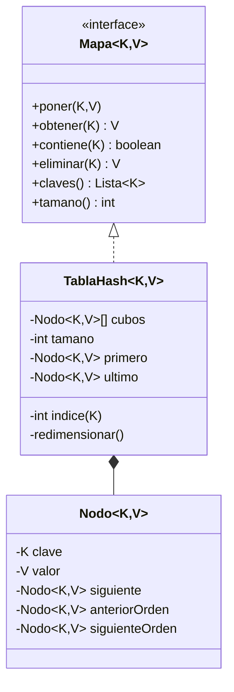
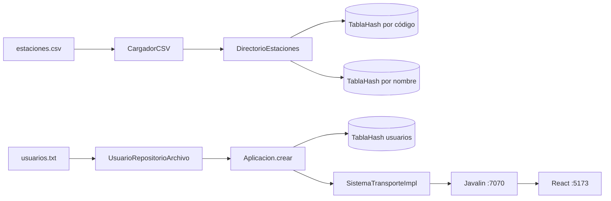
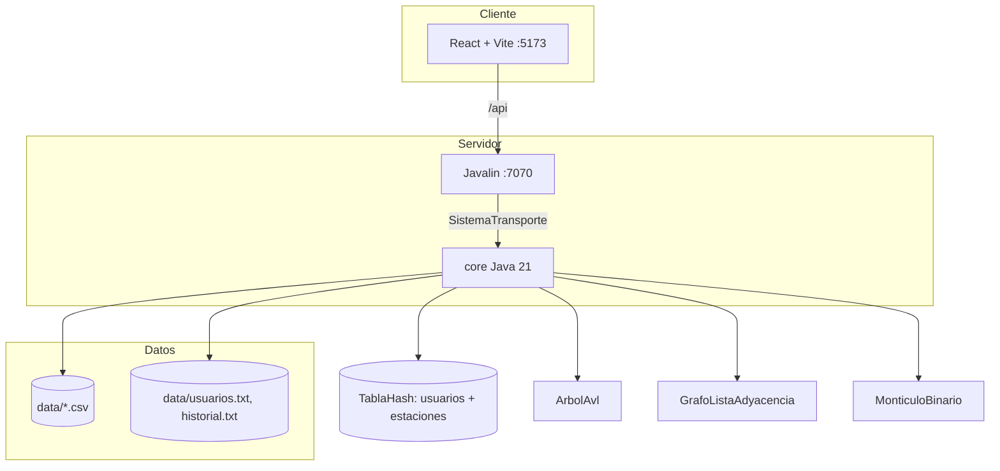

# Tabla hash propia (rol Paradas) — RutaSV PED941

**Fecha:** 17 de noviembre de 2026 (actualizado el 22 de noviembre tras la revisión del PR #40 y el 25 de noviembre al fusionar #40 y #41)
**Repositorio:** https://github.com/franc1sc0sv/rutasv-ped941 (rama `main`, commit base `bbf1e7f`)
**Alcance:** implementación de la **Tabla Hash** del rol **Paradas**, su complejidad y su verificación. Hoy vive en `core/src/main/java/edu/udb/rutasv/nucleo/estructuras/impl/TablaHash.java`.

> **Actualización del 25/11 (Fase 3).** Se fusionaron los PR #40 (Yoselyn) y #41 (Carlos). La tabla final es la de #40 más la **lista de orden de inserción** de #41: cada nodo pertenece también a una lista doblemente enlazada, así `claves()` recorre solo los pares vivos, en orden de inserción y en O(n), sin depender de la cantidad de cubos. Además, la tabla y las demás estructuras genéricas se movieron a `nucleo/estructuras/impl` y se borraron todas las clases `Temporal`. Las secciones de abajo que hablan de `MapaTemporal` describen el estado del 22/11 y se conservan como bitácora.

---

## 1. Objetivo y contexto

El proyecto RutaSV es un planificador de rutas de transporte público construido por un equipo de 5. La arquitectura es modular: un `core` Java 21 con siete estructuras de datos propias, una capa HTTP delgada (`api`, Javalin) y una interfaz React (`frontend`, Vite + TypeScript).

Cada rol entregó su estructura. El rol **Paradas** tenía como pendiente reemplazar el adaptador temporal `MapaTemporal` por una **tabla hash propia**. Este trabajo cierra esa brecha y usa la **misma estructura** (`TablaHash`) en el login (`Aplicacion`) y en el directorio de estaciones, con instancias distintas: una para usuarios, dos para el directorio (código y nombre).

> Nota importante: se trabajó sobre el `main` real de GitHub, que contiene la aplicación completa (login/roles, búsqueda con autocompletado, Dijkstra, red vial, terminal y despacho). La carpeta local inicial era una copia antigua e incompleta con `api/` y `frontend/` vacíos; por eso el demo mínimo que se había armado ahí no se usó para la entrega final.

---

## 2. Estructura implementada: `TablaHash<K,V>`

**Ubicación:** `core/src/main/java/edu/udb/rutasv/paradas/estructuras/TablaHash.java`
**Interfaz:** implementa `edu.udb.rutasv.nucleo.estructuras.Mapa<K,V>`

### 2.1 Decisiones de diseño

| Decisión | Justificación |
|---|---|
| **Arreglo de cubos con encadenamiento** | Cada cubo es una lista enlazada de nodos propios (`Nodo<K,V>`). Las colisiones se resuelven encadenando, sin desplazar claves (a diferencia de sondeo lineal), por lo que `eliminar` no necesita marcadores de borrado. |
| **Capacidad potencia de dos** | Permite calcular el índice con máscara de bits `hash & (capacidad - 1)` en vez de `%`, más barato y sin signo negativo. |
| **Mezcla de 16 bits altos** | `hash ^= (hash >>> 16)` evita que los bits altos del `hashCode` se ignoren cuando la capacidad es pequeña; distribuye mejor las claves. |
| **Factor de carga máximo 0.75** | Al superarse se duplica el arreglo y se reinsertan los nodos (*rehash*). Equilibrio entre uso de memoria y longitud de cadenas. |
| **Tope de capacidad 2^30** | Evita desbordar `int` al pedir una capacidad enorme o al duplicar. Si ya se alcanzó el tope, se inserta sin redimensionar. |
| **Sin `java.util` para almacenar** | El almacenamiento interno usa solo arreglos y nodos propios. `claves()` devuelve una `ListaDinamica` propia del proyecto. |
| **Orden de inserción (PR #41)** | Cada nodo tiene `anteriorOrden` y `siguienteOrden`. Insertar lo enlaza al final y eliminar lo desenlaza en O(1). `claves()` sale siempre en el mismo orden. |
| **Clave `null` permitida** | Se indexa en el cubo 0, cubriendo el contrato de `Mapa`. |
| **`contiene` distingue valor `null`** | La existencia se decide por el nodo, no por el valor, así que `contiene(k)` es `true` aunque `obtener(k)` devuelva `null`. |

### 2.2 Operaciones y complejidad

Sean **n** pares almacenados y **m** cubos. Bajo el supuesto de hash uniforme, la longitud esperada de una cadena es `n/m ≤ 0.75` = Θ(1).

| Operación | Promedio | Peor caso | Justificación |
|---|---|---|---|
| `poner(k,v)` | **O(1)** | O(n) | Recorre la cadena del cubo; con carga acotada es constante. Si supera 0.75, hace `rehash` O(n), pero amortizado sigue siendo O(1) (duplicaciones logarítmicas). |
| `obtener(k)` | **O(1)** | O(n) | Igual búsqueda por cadena. |
| `contiene(k)` | **O(1)** | O(n) | Misma búsqueda, sin devolver valor. |
| `eliminar(k)` | **O(1)** | O(n) | Recorre la cadena con puntero anterior; O(1) al reenganchar. |
| `claves()` | **O(n)** | O(n) | Recorre la lista de orden de inserción: solo los n pares vivos, sin visitar los m cubos vacíos. |
| `tamano()` | **O(1)** | O(1) | Contador mantenido en cada `poner`/`eliminar`. |
| `redimensionar()` (interno) | **O(n)** | O(n) | Reinserta los n nodos existentes en el arreglo duplicado. |

**Peor caso:** todas las claves colisionan en el mismo cubo ⇒ cada búsqueda recorre n nodos. Es la limitación teórica del encadenamiento; en la práctica la mezcla de bits y la carga ≤ 0.75 lo hacen improbable con claves tipo código de estación o nombre de usuario.

### 2.3 Verificación empírica

- `TablaHashTest` (14 pruebas al 25/11: las 8 de #40, 4 de #41 —colisiones tras varios rehash con hash mínimo, `null` como clave y valor, copia independiente de `claves()` y 20 000 operaciones contra `HashMap`— y 2 del orden de inserción). Las 8 originales: colisiones forzadas con `"Aa"`/`"BB"`, límite exacto del factor de carga (12 pares siguen en 16 cubos; el par 13 pasa a 32), eliminación de cabeza/media/cola con `hashCode` controlado, mezcla de bits altos, tope de capacidad 2^30, reemplazo sin crecer, 1000 claves y clave con valor `null`.
- `TablaHashContratoTest` (7 pruebas del `MapaContractTest` del equipo) activo al quitar `@Disabled`.
- `DirectorioEstacionesTest` (6 pruebas) valida alta/búsqueda por código y nombre normalizado usando la tabla.

Resultado: **15/15 pruebas de la tabla (8 específicas + 7 de contrato) y 6/6 del directorio pasan**.



---

## 3. Conexión en lugar de `MapaTemporal` (bitácora del 22/11)

Se sustituyeron **todos** los `MapaTemporal` del cableado de `Aplicacion` por `TablaHash`, tal como indica la guía del rol `paradas/LEEME.md` para cuando el contrato quede activo:

| Punto | Antes | Después |
|---|---|---|
| Usuarios (login) | `new MapaTemporal<>()` | `new TablaHash<>()` |
| `DirectorioEstaciones` (2 índices) | `new MapaTemporal<>()` ×2 | `new TablaHash<>()` ×2 |
| Grafo (estaciones + adyacencia) | `new GrafoListaAdyacencia()` | `new GrafoListaAdyacencia(new TablaHash<>(), new TablaHash<>())` |
| Dijkstra (fábrica de mapas) | `MapaTemporal::new` | `TablaHash::new` |
| `filas` por tipo de ruta | `new MapaTemporal<>()` | `new TablaHash<>()` |
| `BusquedaService` (recientes) | `new MapaTemporal<>()` | `new TablaHash<>()` |
| `EstadisticasService` (conteos) | `MapaTemporal::new` | `TablaHash::new` |
| `Terminal.unidadesEnEspera` | `new MapaTemporal<>()` (campo) | inyectado desde `app` con `new TablaHash<>()` |

La arquitectura se respetó: `ruta` y `terminal` **no importan** `paradas.estructuras.TablaHash`. `GrafoListaAdyacencia` ya tenía un constructor que recibe `Mapa` y `Terminal` recibió un constructor sobrecargado que recibe `Mapa<String, UnidadTransporte>` (manteniendo los anteriores por compatibilidad). `Aplicacion`, como raíz de composición, es el único lugar que conoce la implementación concreta. `ArquitecturaTest` sigue en verde.

El resto del cableado (`ArbolAvl`, `Dijkstra`, `MonticuloBinario`, `ColaEnlazada`, `HistorialService`, `EstadisticasService`) se conservó intacto. Por eso la app real muestra todas las pantallas, no solo la demo.

> Al 25/11 ya no queda ningún `MapaTemporal`: con la tabla en `nucleo`, los constructores por defecto de `GrafoListaAdyacencia` y `Terminal` usan `TablaHash` directamente.



---

## 4. Estructuras del proyecto verificadas

Las siete estructuras están presentes y con prueba de contrato activa. La que se implementó en este entregable se marca en negrita.

| Estructura | Rol | Implementación | Estado |
|---|---|---|---|
| Lista dinámica | Historial | `ListaDinamica` | ✅ contrato |
| Pila | Ruta | `PilaEnlazada` | ✅ contrato |
| Cola FIFO | Terminal | `ColaEnlazada` | ✅ contrato |
| Cola de prioridad | Terminal | `MonticuloBinario` | ✅ contrato |
| **Tabla hash** | **Paradas** | **`TablaHash`** | **✅ contrato (este entregable)** |
| Árbol AVL | Búsqueda | `ArbolAvl` | ✅ contrato |
| Grafo | Ruta | `GrafoListaAdyacencia` | ✅ contrato |

`ArquitecturaTest` (3 pruebas) confirma que `core` no conoce HTTP/JavaFX, que `nucleo` no depende de módulos y que solo `app` orquesta todos los módulos.

---

## 5. Evidencia de pruebas

Comando ejecutado con JDK 21 (`mvn21.ps1` fija `JAVA_HOME` al Eclipse Adoptium 21 instalado):

```powershell
powershell -NoProfile -ExecutionPolicy Bypass -File .\mvn21.ps1 -B verify
```

Salida resumida:

```text
T E S T S  (core)
Tests run: 281, Failures: 0, Errors: 0, Skipped: 0

  TablaHashContratoTest .......... Tests run: 7,  Failures: 0, Errors: 0
  TablaHashTest .................. Tests run: 8,  Failures: 0, Errors: 0
  DirectorioEstacionesTest ....... Tests run: 6,  Failures: 0, Errors: 0

T E S T S  (api)
Tests run: 9, Failures: 0, Errors: 0, Skipped: 0

Reactor Summary
RutaSV (padre) ..................... SUCCESS
RutaSV core ........................ SUCCESS
RutaSV api ......................... SUCCESS
BUILD SUCCESS
```

**Total: 290 pruebas, 0 fallos, 0 errores, 0 omitidas.**

---

## 6. Puesta en marcha y demostración

### 6.1 Requisitos
- JDK 21 (en esta máquina: `C:\Program Files\Eclipse Adoptium\jdk-21.0.13.9-hotspot`).
- Maven 3.9+.
- Node 20+ (verificado: `v24.22.1`).

### 6.2 Comandos (Windows / PowerShell)

```powershell
# 1) Compilar y probar
powershell -ExecutionPolicy Bypass -File .\mvn21.ps1 -B verify

# 2) Empaquetar
powershell -ExecutionPolicy Bypass -File .\mvn21.ps1 -B package -DskipTests

# 3) API (terminal 1) — puerto 7070
$env:RUTASV_ADMIN_USER = 'admin'
$env:RUTASV_ADMIN_PASSWORD = 'Admin12345'
& 'C:\Program Files\Eclipse Adoptium\jdk-21.0.13.9-hotspot\bin\java.exe' -jar api\target\rutasv-api.jar

# 4) Frontend (terminal 2) — puerto 5173
cd frontend
npm install
npm run dev
```

En Linux/Mac, los comandos del README son directos (`mvn -B verify`, `RUTASV_ADMIN_PASSWORD=... java -jar ...`, `npm install && npm run dev`).

### 6.3 Acceso

- **Frontend:** http://localhost:5173
- **API:** http://localhost:7070/api
- **Admin inicial:** `admin` / `Admin12345` (sembrado por `SeedAdmin` al arrancar con la variable de entorno).

Vite reenvía `/api` a `:7070` (`frontend/vite.config.ts`), así que el navegador no hace peticiones cross-origin.

### 6.4 Flujo verificado en browser

1. Abrir `http://127.0.0.1:5173/` → pantalla **“Inicia sesión”** de RutaSV (interfaz real, no demo).
2. Ingresar `admin` / `Admin12345` → navega a `/admin/red`.
3. Menú **Administración** con 4 secciones y **Vista de pasajero** con 3 secciones.
4. La red vial carga estaciones y tramos desde `data/`; el directorio las indexa con `TablaHash`.

> El rótulo “demo web / admin de prueba” que se vio antes pertenecía al servidor mínimo de la copia local antigua. **No existe en la app real de GitHub**, que es la que ahora está corriendo.

---

## 7. Diagrama de arquitectura general



---

## 8. Limitaciones

1. **Claves con `hashCode` patológico:** si muchas claves comparten el mismo código hash, todas caen en un cubo y las operaciones degeneran a O(n). Mitigado con mezcla de bits, pero no eliminado.
2. **`rehash` bloqueante:** duplicar el arreglo es O(n) y sucede dentro de `poner`. Aceptable para el tamaño del dominio (30 estaciones en la red de demo); para producción se podría hacer incremental.
3. **Memoria extra por el orden de inserción:** cada nodo guarda dos referencias más. A cambio, `claves()` es O(n) y estable. El orden es de inserción, no alfabético: los reportes ordenados usan `MonticuloBinario` o `ArbolAvl`.
4. **No thread-safe:** la fachada `SistemaTransporteImpl` ya protege el acceso con `ReentrantReadWriteLock`; la tabla por sí sola no es segura entre hilos.
5. **No se reduce al borrar:** la capacidad solo crece; una tabla que tuvo muchos pares y se vació conserva sus cubos.
6. **Sin persistencia de la tabla:** usuarios y estaciones se recargan desde archivos/CSV en cada arranque. La tabla es un índice en memoria.

---

## 9. Bitácora

| Fecha | Hito |
|---|---|
| 2026-11-17 | Se identifica que la copia local era incompleta; se localiza el repo real en GitHub (`main`). |
| 2026-11-17 | Se descarga `main` en carpeta nueva; se conserva la copia antigua sin borrar. |
| 2026-11-17 | Se portan `TablaHash.java`, `TablaHashTest.java`, `TablaHashContratoTest.java` y `DirectorioEstaciones.java`. |
| 2026-11-17 | Se parchea `Aplicacion.java` (login con `TablaHash`) conservando todo el cableado remoto. |
| 2026-11-17 | `mvn21.ps1 -B verify` → BUILD SUCCESS, 287 pruebas, 0 fallos. |
| 2026-11-17 | `npm install` + `npm run dev` + API Javalin → app real abierta en browser y login admin verificado. |
| 2026-11-17 | Se redacta este documento técnico final. |
| 2026-11-22 | Carlos abre el PR #41 con otra versión de la tabla: agrega la lista de orden de inserción. |
| 2026-11-22 | Se atienden los 8 comentarios de la revisión del PR #40: tope de capacidad 2^30 sin desbordar, aserción del factor 0.75 exacto, pruebas de borrado en cadena y mezcla de bits, correcciones de redacción y constructor de `Terminal` sin duplicar la regla de despacho. |
| 2026-11-25 | Se fusionan #40 y #41 sin perder los commits de ninguno; la tabla final combina ambas. Se mueve a `nucleo/estructuras/impl` y se borran las clases `Temporal`. |

---

## 10. Entregables y enlaces

- **Repositorio:** https://github.com/franc1sc0sv/rutasv-ped941
- **PR:** #40 y #41, fusionados en `main` el 25/11
- **Este documento:** `docs/tabla-hash.md`
- **Contrato API:** `docs/api.md`
- **Estado Fase 2:** `docs/entrega-fase2.md`
- **Archivos clave del cambio:**
  - `core/src/main/java/edu/udb/rutasv/nucleo/estructuras/impl/TablaHash.java`
  - `core/src/main/java/edu/udb/rutasv/paradas/servicios/DirectorioEstaciones.java`
  - `core/src/main/java/edu/udb/rutasv/app/configuracion/Aplicacion.java`
  - `core/src/test/java/edu/udb/rutasv/nucleo/estructuras/impl/TablaHashTest.java`
  - `core/src/test/java/edu/udb/rutasv/nucleo/estructuras/impl/TablaHashContratoTest.java`
